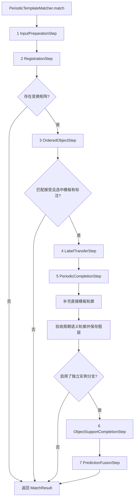

# Matcher 的 Step、类职责与阅读入口

## 1. 先看哪里

- **调用 API**：[matcher.py](matcher.py) 的 `PeriodicTemplateMatcher`。
  持有配置和预处理后的输入，组装各个推理步骤，对外提供文件推理、数组推理、评价和导出。
- **查看执行顺序**：[_internal/pipeline.py](_internal/pipeline.py) 的 `MatchPipeline.run()`。
  不使用动态注册器或隐藏的 Step 调度，直接列出执行顺序与提前返回条件。
- **查看某一步实现**：按功能进入下表中的配准、实例或分割目录，Step 与对应算法放在一起。
- **查看数值计算**：Step 调用已有算法函数，见下表。纯计算函数保持为函数，
  不为了“全部变成类”额外增加继承或包装层。
- **JSON / 文件入口**：[_internal/io/workflow.py](_internal/io/workflow.py) 的 `InferenceFiles`
  负责路径解析、模板去重、读取图像与标注、附加输出元信息和检查输出路径。
  `run_config()` 创建 Matcher 并调用 `infer_to()`。文件与数组入口都执行 `MatchPipeline`。

用 JSON 路径创建 Matcher 时，初始化会读取模板、标注、有效掩膜及默认目标，
并准备配准特征、默认目标的周期晶格和 ECC 金字塔。
传入其他目标路径时，只读取新目标。模板配准特征保留初始化倍率和最近一次其他倍率的结果。
已初始化的文件 Matcher 使用创建时的配置快照。配置或模板变更后创建新实例。

### 目录按功能归组，不再平铺算法或另外维护 steps 目录

| 入口 | 职责 | 所属类 / 主要实现 |
|---|---|---|
| [pipeline.py](_internal/pipeline.py) | 唯一推理编排入口 | `MatchPipeline` |
| [models.py](_internal/models.py) | 公共结果与跨步骤数据契约 | `MatchResult`、`EvaluationResult`、`PreparedInputs` 等 |
| [registration/step.py](_internal/registration/step.py) | 配准领域 | `RegistrationStep`；同目录的 core / opencv 模块提供数值算法 |
| [objects/steps.py](_internal/objects/steps.py) | 实例领域 | `OrderedObjectStep`、`ObjectSupportCompletionStep`；matching / completion / axes / fusion 同目录 |
| [segmentation/transfer.py](_internal/segmentation/transfer.py) | 分割领域 | `LabelTransferStep`、`PeriodicCompletionStep`；preparation / periodic / evaluation 同目录 |
| [io/workflow.py](_internal/io/workflow.py) | 文件流程领域 | JSON 路径和配置工作流；annotations / export 同目录 |

内部顶层只有包入口、流水线和共享模型三个 Python 文件，另有四个功能目录。
旧平铺模块和旧步骤目录已删除，不保留转发文件、动态导入别名或重复实现。

### 算法模块的阅读顺序

| 模块 | 负责什么 |
|---|---|
| [registration/core.py](_internal/registration/core.py) | 工作分辨率预处理、候选变换搜索、多模板排序与接受决策 |
| [registration/correlation.py](_internal/registration/correlation.py) | FFT 平移相关峰搜索、周期晶格诊断 |
| [registration/scoring.py](_internal/registration/scoring.py) | 结构相关性、边缘与局部一致性评分，以及受约束的 ECC 细化 |
| [objects/matching.py](_internal/objects/matching.py) | 组织对象候选生成、布局选择和预测输出 |
| [objects/appearance.py](_internal/objects/appearance.py) | 在真实可见交集上搜索对象外观相关峰 |
| [objects/layout.py](_internal/objects/layout.py) | 候选质量、参考间距估计、循环身份顺序求解 |
| [segmentation/instances.py](_internal/segmentation/instances.py) | 融合前独立验收已知语义背景中的周期小实例，保护语义分支已有前景 |
| [segmentation/occlusion.py](_internal/segmentation/occlusion.py) | 常规补全后，从已验证的同相位周期恢复缺陷遮挡的前景 |

`core` 与 `matching` 保留原有辅助函数的导入入口；函数实现只存在于对应职责模块中。
周期分割与对象补全直接复用 `scoring`，不通过配准搜索流程访问评分算法。

`step3.robust_appearance` 在 SD-1 OpenCV 配置中开启。基础配准未达标时，使用低频特征重新评分已有候选；
有基础配准但对象证据不足时，仍按配置中的分数和身份顺序规则重新搜索对象。遮挡补全需要已验证的目标周期、
同相位可见纹理，以及目标的纹理损失或连续暗遮挡。较大的邻域提供位置证据，语义前景取自原始模板标注。
语义轮廓从待补区跨入直接背景时须属于同一连通分量，对象延伸须与同一身份的已有轮廓连通。
`Features` 表示归一化亮度、梯度、边缘和有效区域四元组；对象候选中的
`_mask`、`_support` 等字段包含内部数组，不属于可序列化的诊断输出。

此次拆分保持评分公式、阈值、候选顺序和接受规则不变，目标是降低后续维护成本。

## 2. 推理执行顺序

2026-11-05 增加局部周期模式：`object_visible_count` 将输入可见身份数与
`object_cycle` 的完整周期分离。显式设置后，模板可提供连续的局部周期参考，
对象候选池汇集所有已配置模板；全图几何未批准的模板使用配置角度/尺度的局部外观假设。
`solve_layout` 对所有周期起点求固定可见长度窗口，身份编码仍按完整 cycle 排序。

此模式下对象分支也可在缺少基础变换时运行。基础语义不可用而局部对象证据通过时，
流水线返回 `accepted_objects_only`，只标记对象前景为已知，保留基础配准状态，
不执行基础标签迁移或依赖基础晶格的补全。未设置 visible_count 时沿用下图的完整周期行为。

注意：步骤 3 必须在“匹配是否接受”的最终判断之前执行。只有模板分数接近
（`templates_too_close`）时，强实例证据才可能解除模板选择歧义；它不能把普通低分匹配改成接受。
步骤 6 在步骤 5 后执行，复用基础周期分支验证的几何。全图语义复制未通过时，已确认的对象可沿目标图独立验证的周期提出补全，实际像素仍须通过对象分支的局部验证。
可选语义轮廓补全在最终融合前执行，冻结当前语义轮廓作为来源，并验证目标的周期证据。
完整的直接匹配轮廓可沿目标图已验证的周期延伸到主模板投影外。已有覆盖部分须与轮廓一致，只补通过局部验证的前景。
直接匹配、周期补全和独立对象各自保存已验证的图层。重叠像素的最终类别由融合优先级决定。
该小型算法直接以具名函数调用，不增加只有转发作用的 Step 包装类。

## 3. 每个功能所属的类

| Step / 类 | 负责什么 | 不负责什么 | 实现 / 算法入口 |
|---|---|---|---|
| 1 `InputPreparationStep` | 数组与数量校验、标签归一化、有效高度与图像 ROI、实例参考校验及 `background_known` | 提取特征、配准、读文件 | [preparation.py](_internal/segmentation/preparation.py)；复用 `ValidRegion` |
| 2 `RegistrationStep` | 模板选择、记录配置/ROI、创建结果、直接图像和几何有效范围投影 | 标签迁移、实例融合 | [步骤实现](_internal/registration/step.py) → [配准算法](_internal/registration/core.py) 的 `select_templates()` |
| 3 `OrderedObjectStep` | 组织各模板实际已知参考、独立身份定位、仅在模板接近时使用实例证据消歧 | 全局晶格复制实例、支持补全 | [steps.py](_internal/objects/steps.py) → [matching.py](_internal/objects/matching.py) 的 `match_ordered_objects()` |
| 4 `LabelTransferStep` | 在图像和标注都有效的位置迁移主模板标签，再用局部验证过的其他配准模板覆盖缺口。独立实例类别单独定位 | 直接图层与已知范围 | [transfer.py](_internal/segmentation/transfer.py) |
| 5 `PeriodicCompletionStep` | 用直接迁移后的剩余缺口驱动周期补全。其他模板沿已验证周期只验证候选轮廓 | 周期图层与身份支持所需的几何 | [periodic.py](_internal/segmentation/periodic.py) |
| 6 `ObjectSupportCompletionStep` | 筛选已批准的晶格几何，把源周期向量换算到目标原图坐标，补全已定位身份的支持 | 无证据生成身份、沿排列轴复制实例 | [步骤实现](_internal/objects/steps.py) → [completion.py](_internal/objects/completion.py) 的 `complete_object_support()` |
| 7 `PredictionFusionStep` | 保存基础预测快照、保护基础前景、融合实例及身份图、协调未知区域与最终覆盖统计 | 再次匹配、修改阈值 | [fusion.py](_internal/objects/fusion.py) |
| `complete_periodic_instances()` | 冻结完整非身份轮廓，依据目标图周期、像素、结构和边缘证据补全语义前景 | 覆盖已有语义前景、传播身份、认证未知背景、修改健康模板、增添 ECC 或自举 | [instances.py](_internal/segmentation/instances.py) |
| 可选 `SegmentationEvaluationStep` | 校验 GT 与评价 ROI，对最终结果计算指标，处理拒绝/无标注情况 | 用 GT 指导任何推理步骤 | [evaluation.py](_internal/segmentation/evaluation.py)，同模块定义 `evaluate_segmentation()` |
| `MatchPipeline` | 控制顺序、分支和提前返回；持有每个 Step | IO、数值匹配、评价 | [pipeline.py](_internal/pipeline.py) |

### 数值算法内部再看哪里

- **特征、粗搜索、模板排序**：[_internal/registration/core.py](_internal/registration/core.py)。
  `PreparedImage` 保存配准工作分辨率数据；`_prepare_image()` / `_features()` 预处理，
  `_coarse_candidates()` 生成候选，`_refine_candidates()` 组织精化与评分，
  `_register_prepared()` 验证单模板，`select_templates()` 排序多个模板。
- **ECC 与评分**：[_internal/registration/scoring.py](_internal/registration/scoring.py)
  的 `_refine()`、`_score()`；FFT 相关峰与晶格诊断见
  [_internal/registration/correlation.py](_internal/registration/correlation.py)。
- **OpenCV 粗搜索后端**：[_internal/registration/opencv.py](_internal/registration/opencv.py)。
- **周期来源、锚点验证、副本及逐区域验证、类别重复方向**：
  [_internal/segmentation/periodic.py](_internal/segmentation/periodic.py)。
- **身份候选生成**：[_internal/objects/matching.py](_internal/objects/matching.py)，
  外观相关峰计算见 [_internal/objects/appearance.py](_internal/objects/appearance.py)。
- **循环顺序与邻接间距动态规划**：
  [_internal/objects/layout.py](_internal/objects/layout.py) 的 `solve_layout()` 等函数。
- **白色遮挡证据、实例支持的逐区域验证**：
  [_internal/objects/completion.py](_internal/objects/completion.py)。
- **纵向排列的可逆转置适配**：[_internal/objects/axes.py](_internal/objects/axes.py)。
- **配置和方向策略**：[config.py](config.py) 的 `MatcherConfig`。
- **结果数据**：[_internal/models.py](_internal/models.py) 的 `MatchResult` / `EvaluationResult`。
- **导出与查看**：[_internal/io/export.py](_internal/io/export.py) 负责保存，
  [app/README.md](app/README.md) 说明独立查看器。Step 不接触输出路径。

## 4. Step 之间传什么

共享数据契约与结果类统一定义在 [_internal/models.py](_internal/models.py)，不是一个任意读写的大字典：

| 数据类 | 内容 | 生产者 → 消费者 |
|---|---|---|
| `PreparedInputs` | 原始图像、归一化标签、分别保存的图像 ROI / 标注有效范围、实例参考、ROI 诊断 | 输入准备 → 全部推理步骤 |
| `RegisteredMatch` | 结果、选中模板索引、源到目标的变换矩阵 | 配准 → 实例定位、标签迁移、补全和融合 |
| `TransferredLabels` | 去掉独立实例类别的源标签、已与图像 ROI 相交的源标注有效范围 | 标签迁移 → 基础周期补全 |
| `LocatedObjects` | `ObjectPrediction` 与本次定位实际使用的源证据 mask | 实例定位 → 支持补全、融合 |
| `PreparedGroundTruth` | GT 标签与评价有效范围 | 评价准备 → 最终评价；不传给 `MatchPipeline` |

实例领域专用的 `LocatedObjects` 定义在 [steps.py](_internal/objects/steps.py)，
评价专用的 `PreparedGroundTruth` 定义在 [evaluation.py](_internal/segmentation/evaluation.py)。
诊断内容继续使用原有字典和键名，保持保存格式兼容。

每次 `match()` 创建独立的准备数据和流水线；Step 不保存上一次调用的中间结果。
输入数组只读使用；需要剔除实例类别或写入 `background_known` 时先复制对应标签/参考字典。
`MatchResult` / `ObjectPrediction` 是本次运行的可变输出，补全及融合有意在其上更新。

## 5. 必须保持的语义

1. **图像 ROI ≠ 标注知识**：图像 ROI 用于外观证据；标注有效范围表示标签已知与否，
   未知不能变成背景。高度在输入准备阶段解析，配准阶段清除高度/底部比例策略，避免再次裁行。
   启用周期补全时，其他模板提供的背景先记为候选，在前景补全结束后确认剩余背景。
2. **所有 Step 接口使用原图坐标**：矩阵为模板原图 → 目标原图，周期向量来自源原图；
   支持补全通过矩阵的线性部分换算向量，不能加上平移量。算法内部自行处理工作分辨率/转置。
3. **几何批准 ≠ 标签副本接受**：`geometry_accepted` 与 `accepted` 不能混用。
   支持补全可利用已批准几何，但实际填充还必须通过实例分支自身验证。
4. **独立实例类别不走全局晶格复制**：身份先按外观和排列关系确认，重复方向仍遵守类别策略。
5. **融合优先级**：完整周期模式保护基础前景；显式局部周期模式下，已验证身份的实例前景优先，
   防止基础周期错相位切掉实例分叉。原基础标签保留在快照中，冲突与覆盖计数分别为
   `foreground_conflict_pixels`、`instance_priority_pixels`。未知身份不覆盖基础前景。
  最终单通道优先级不影响独立来源：`direct_labels/direct_valid` 在移除独立匹配的 ordered 类之后保存，
  `completion_labels/completion_valid` 保存周期候选验收后的原始前景轮廓，允许和直接层重叠。
  `label_periodic_valid` 跟踪周期阶段实际写入融合结果的像素。
  `object_labels/object_layer_valid/object_layer_identities` 保留未被优先级裁剪的对象证据。
  来源之间允许重叠，查看器不能用最终互斥标签反推这些层；GT 评价仍针对原最终预测。
6. **基础快照包含基础周期补全**：`base_labels` / `base_valid` 在基础周期补全与直接轮廓补充之后保存，
  独立语义轮廓补全另存于周期图层。
  `warped_template` / `geometric_valid` 才描述直接几何。
7. **评价与推理解耦**：GT 只进入 `SegmentationEvaluationStep`，不会进入配准或补全。

## 6. 修改功能时找哪里

- 修改有效高度/输入校验：`InputPreparationStep`；区域策略算法改 `ValidRegion`。
- 修改模板接受与排序：`RegistrationStep` 的配准算法；不要在融合里补判接受状态。
- 修改身份消歧条件：`OrderedObjectStep`；修改候选或循环 DP 则进入身份算法。
- 修改类别周期限制/周期副本验证：`PeriodicCompletionStep` 所调用的周期算法。
- 修改白色缺陷下的实例标签迁移：`ObjectSupportCompletionStep` 所调用的支持补全算法。
- 修改实例与普通类别重叠时的优先级：`PredictionFusionStep`。
- 新增推理步骤：在所属功能目录实现具名类，并在 `MatchPipeline.run()` 明确插入调用；
  为其输入/输出及前后顺序增加测试，不需要新增基类或插件注册机制。

## 7. 兼容与验证

公共 `match()` / `evaluate()` / `save_result()` 签名、结果字段、JSON 规则、
FFT/OpenCV 数值内核及阈值均不因本次职责拆分而改变。
原 `_valids()` / `_prepare_regions()` 保留为兼容委派，实际实现仅在输入准备类中维护。
门面保留现有算法替换点，通过 Step 构造函数注入，原有单测无需批量修改 mock 路径。
内部模块路径随目录整理更新；所有调用方和测试同步迁移。不承诺 `_internal` 旧导入路径兼容，
公开的包级导入与 API 不变。

[tests/test_match_pipeline.py](../tests/test_match_pipeline.py) 新增 14 项测试，
覆盖 Step 顺序、提前返回、实例证据解除模板歧义、ROI 策略只应用一次、输入不变性、
几何批准与标签批准分离、周期向量变换、基础前景保护及 GT 隔离。

目录重组另在 [tests/test_package.py](../tests/test_package.py) 增加两项检查：
顶层只允许流水线/共享模型，以及全新解释器能够导入全部领域模块。

2026-10-29 目录重组后完整回归：137 项，136 项通过；真实 SD-1 顺时针旋转的类别 2 一致性
IoU 为 0.8966673810，未达到现有测试的 0.90 门限。
用重构前暂存区中的 matcher 实现在内存中独立复测，同一用例得到完全相同的失败值。
另外分别对 SD-1 原始方向、顺时针 90°、逆时针 90° 执行新旧实现对照：
每个方向的全部 14 个结果数组逐像素一致，完整配准诊断字典也一致。
这是已有算法/数据下的旋转一致性问题；本次不调整算法和门限来掩盖它。
